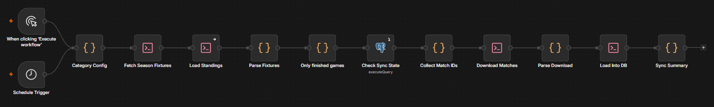

# ArgStats · n8n Updates

**English** · [Español](docs/README.es.md)

Weekly pipeline that keeps the [**ArgStats**](https://github.com/smalirat/arg-stats) database up to date.

It's orchestrated by **n8n**, and the heavy lifting is done by **Python** scripts based on [**arg-football-scrapper**](https://github.com/smalirat/arg-football-scrapper): scraping with an automated browser and batched loading into **PostgreSQL on Supabase**.

| Competition | Workflow |
|---|---|
| Liga Profesional (Apertura, Clausura and playoffs) | `argstats-liga-profesional.json` |
| Primera Nacional | `argstats-primera-nacional.json` |
| Primera B Metropolitana | `argstats-primera-b-metro.json` |
| Federal A | `argstats-federal-a.json` |
| Copa Argentina | `argstats-copa-argentina.json` |

## How it works

All five workflows share the same flow. The only difference is the *Category Config* node, which sets the league, season, filter and per-run cap.



1. **Fixtures and tables.** A single request per competition. The response is cached and reused to load the standings.
2. **What's missing.** One database query returns the finished matches that are not loaded yet or are incomplete (no result or no player details).
3. **Download.** A single browser for the whole run, with random pauses between requests. Each match is saved as JSON. Finished matches that are already saved are never requested again.
4. **Load.** The JSON files are turned into rows and written with one multi-row `INSERT … ON CONFLICT` per table, in a single transaction. If something fails, it retries match by match to isolate the one that breaks.

## Technical decisions

- **Scraping decoupled from loading.** If the database fails, the JSON files stay on disk and the next run loads them without fetching them again, so the source only gets the requests that are strictly needed.
- **Batched loading.** The first version ran ~350 queries per match (one per player, event and shot). Against Supabase, at ~160 ms per query, that meant ~1 minute per match. Batching by table brings it down to a handful of queries per run: 300 matches load in ~2 s.
- **Changing IDs.** The source changes a match's ID once its date is confirmed. To avoid duplicates, when a new ID arrives it replaces the unplayed match with the same fixture and edition (within a ±21-day window). A match with a result is never deleted.
- **Full player stats.** Besides minutes, goals, xG and rating, each player's match row stores the metrics other sources also publish (passes, crosses, chances created, dribbles, tackles, interceptions, duels, fouls, penalties, saves...) as columns, and what is specific to FotMob (defensive actions, keeper sweeps, player of the match...) in a `fotmob` JSONB column, with no duplicates. Cards come from the match events, each lineup row stores the minute the player came on or off, and each goal its assist: with that, the lower divisions (where the source publishes no player stats) still get squad tables.
- **Changing formats.** The format of FotMob's JSON changes from time to time. For example, the source went from `"Liga Profesional Clausura"` + round `"13"` to `"Liga Profesional Argentina"` + `"Clausura - Round 13"`. The ETL normalizes everything to the database's historical format, playoffs included (`"Apertura - Quarter-finals"` → edition `… Apertura Playoff`, round `1/4`). Since the 2026 Clausura, goals and cards also arrive with `eventId` 0: they get a stable negative ID per match so they are not lost. Because of this, some scripts may need occasional updates.
- **Two divisions in one league.** The source groups Primera B Metro and Federal A together. They are split based on which tables each match's teams appear in (462 and 511 matches in 2026, no mixed cases).
- **Backlog doesn't block new matches.** Each run downloads at most 150 matches: first the ones with no result in the database, then the rest, most recent first. In the lower divisions the source doesn't publish player details, so those matches always look "incomplete"; without this order they took up the whole cap and new results fell behind.
- **Rescheduled matches.** The source confirms the date and time of unplayed matches a few days before. Each run updates the date of the pending matches already in the database.

## Structure

```
├── README.md                   Main README (English)
├── start-n8n.ps1               Starts n8n with the project paths
├── docs/
│   ├── README.es.md            Spanish version of this README
│   └── workflow.png            Screenshot of the n8n workflow
└── project/
    ├── workflows/              One n8n workflow per competition (exported JSON)
    ├── scripts/
    │   ├── fotmob_sync.py      Scraping: fixtures and match details (no database)
    │   ├── load_matches.py     Match loading (no browser)
    │   ├── load_standings.py   Standings loading
    │   └── fotmob_etl.py       Normalization and batched writes to PostgreSQL
    ├── requirements.txt
    └── .env.example
```

Not versioned:
- `data/`: the n8n database, with credentials and execution history.
- `project/.runtime/`: the browser profile, downloaded JSON files and backups.
- `project/.venv/` and `.env`.
- `app/` and `npm-cache/`: leftovers from installing n8n with npm.

## Running it

Requires Python 3.13 (nodriver doesn't work with 3.14 yet), Node.js with n8n (`npm i -g n8n`) and Chrome.

```powershell
cd project
py -3.13 -m venv .venv
.\.venv\Scripts\python.exe -m pip install -r requirements.txt
copy .env.example .env          # ARGSTATS_DB_URL = PostgreSQL / Supabase connection string
cd ..
```

With n8n stopped, import the workflows:

```powershell
$env:N8N_USER_FOLDER = "$PWD\data"; n8n import:workflow --separate --input=project\workflows
```

Start n8n, create the *Postgres account* credential pointing to the same database, and run the workflow for a competition:

```powershell
powershell -ExecutionPolicy Bypass -File .\start-n8n.ps1     # http://localhost:5678
```

The workflows share the browser profile, so run them one at a time. The *Schedule Triggers* are staggered 30 minutes apart.
